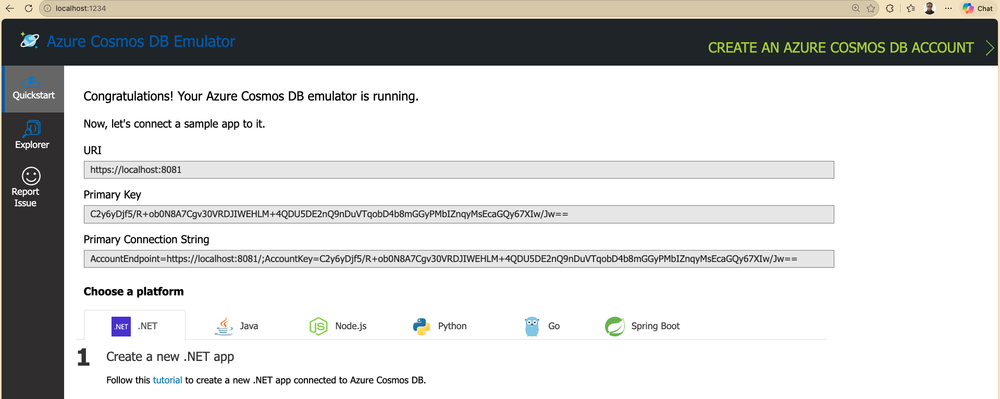
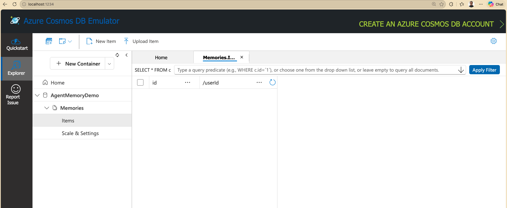
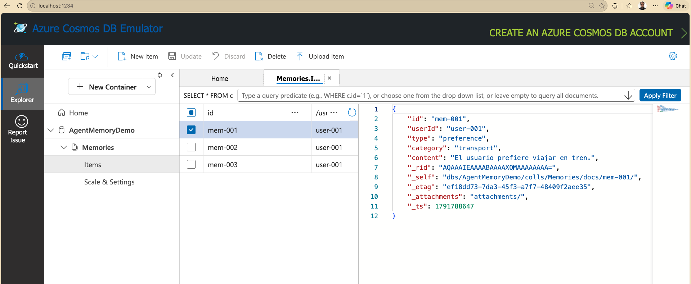
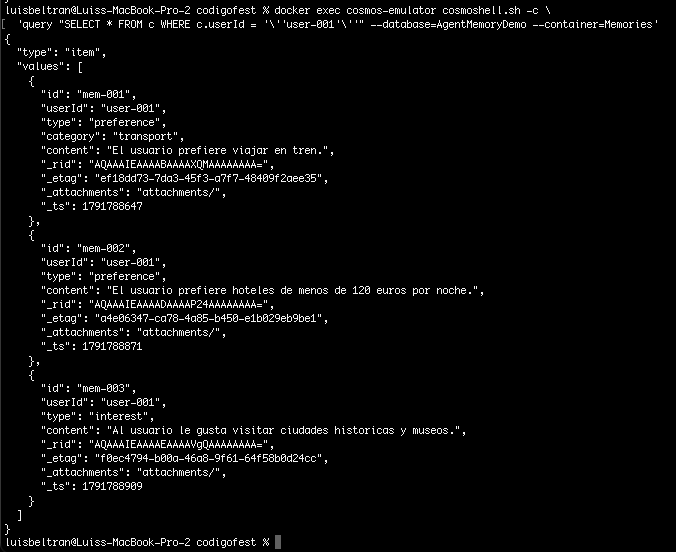

## Demo 1: Cosmos DB Emulator: Almacenamiento JSON local

### 1. Iniciar el emulador

Ejecuta en una terminal:

```bash
docker pull mcr.microsoft.com/cosmosdb/linux/azure-cosmos-emulator:vnext-latest
```

Inicia el emulador:

```bash
docker run -d \
  --name cosmos-emulator \
  -p 8091:8081 \
  -p 8090:8080 \
  -p 1234:1234 \
  mcr.microsoft.com/cosmosdb/linux/azure-cosmos-emulator:vnext-latest
```

Comprueba su ejecución:

```bash
docker ps
```

Verifica que el emulador está preparado:

```bash
curl http://localhost:8090/ready
```

Abre el explorador de datos visitando `http://localhost:1234`



El emulador proporciona el endpoint local `http://localhost:8091`, mientras que el puerto `1234` corresponde al explorador visual.

### 2. Crear una base de datos y un contenedor

Utilizaremos **Cosmos DB Shell**, que ya viene incluido en el contenedor del emulador. No hay que instalar herramientas adicionales.

```bash
docker exec cosmos-emulator cosmoshell.sh -c 'mkdb AgentMemoryDemo'
```

Crea un contenedor llamado `Memories` con clave de partición `/userId`:

```bash
docker exec cosmos-emulator cosmoshell.sh -c 'mkcon Memories /userId --database=AgentMemoryDemo'
```

Ahora abre o actualiza **Data Explorer** y comprueba que se muestran:



| Concepto | Descripción |
|---|---|
| Base de datos | Agrupa contenedores lógicos y relacionados |
| Contenedor | Almacena documentos JSON y define el esquema de partición |
| Clave de partición | Organiza los datos por un valor clave, como `userId` |

Una base de datos contiene contenedores, y estos almacenan documentos JSON. La clave de partición permite organizar la información; para nuestra demo utilizaremos el identificador del usuario.

### 3. Insertar documentos JSON

Insertaremos tres recuerdos ficticios del mismo usuario. Ejecuta los siguientes comandos en una terminal.

**Memoria 1: Preferencias de transporte**

```bash
docker exec cosmos-emulator cosmoshell.sh -c \
  'mkitem -container Memories --database=AgentMemoryDemo {"id":"mem-001","userId":"user-001","type":"preference","category":"transport","content":"El usuario prefiere viajar en tren."}'
```

**Memoria 2: Preferencias de alojamiento**

```bash
docker exec cosmos-emulator cosmoshell.sh -c \
  'mkitem -container Memories --database=AgentMemoryDemo {"id":"mem-002","userId":"user-001","type":"preference","content":"El usuario prefiere hoteles de menos de 120 euros por noche."}'
```

**Memoria 3: Intereses**

```bash
docker exec cosmos-emulator cosmoshell.sh -c \
  'mkitem -container Memories --database=AgentMemoryDemo {"id":"mem-003","userId":"user-001","type":"interest","content":"Al usuario le gusta visitar ciudades historicas y museos."}'
```

En **Data Explorer** podrás inspeccionar los tres documentos JSON.



### 4. Consultar recuerdos almacenados

Ejecuta una consulta SQL para recuperar las memorias del usuario:

```bash
docker exec cosmos-emulator cosmoshell.sh -c \
  'query "SELECT * FROM c WHERE c.userId = '\''user-001'\''" --database=AgentMemoryDemo --container=Memories'
```



También puedes consultar únicamente las preferencias:

```bash
docker exec cosmos-emulator cosmoshell.sh -c \
  'query "SELECT * FROM c WHERE c.type = '\''preference'\''" --database=AgentMemoryDemo --container=Memories'
```

Y contar los recuerdos almacenados:

```bash
docker exec cosmos-emulator cosmoshell.sh -c \
  'query "SELECT VALUE COUNT(1) FROM c" --database=AgentMemoryDemo --container=Memories'
```

Estos comandos utilizan las operaciones `mkitem` y `query` documentadas para **Cosmos DB Shell**.

### 5. Comandos de administración

| Acción | Comando |
|---|---|
| Detener el emulador | `docker stop cosmos-emulator` |
| Volver a iniciarlo | `docker start cosmos-emulator` |
| Consultar logs | `docker logs cosmos-emulator --tail 30` |
| Eliminar el contenedor | `docker rm -f cosmos-emulator` |

Ejemplos:

```bash
docker stop cosmos-emulator
docker start cosmos-emulator
docker logs cosmos-emulator --tail 30
docker rm -f cosmos-emulator
```

### Resumen

* Cosmos DB puede ejecutarse localmente en un contenedor Docker.
* Podemos crear bases de datos y contenedores mediante comandos.
* Los recuerdos de un usuario pueden representarse como documentos JSON.
* Podemos recuperar esos recuerdos mediante consultas SQL.

Hasta aquí hemos almacenado recuerdos manualmente. En la siguiente demo, el **Agent Memory Toolkit** y **Microsoft Foundry** permitirán automatizar su captura y recuperación desde las conversaciones de un agente.

[Demo 2 →](demo2.md)