## Demo 2: Agent Memory Toolkit: memoria persistente entre sesiones

### Lo que vamos a construir

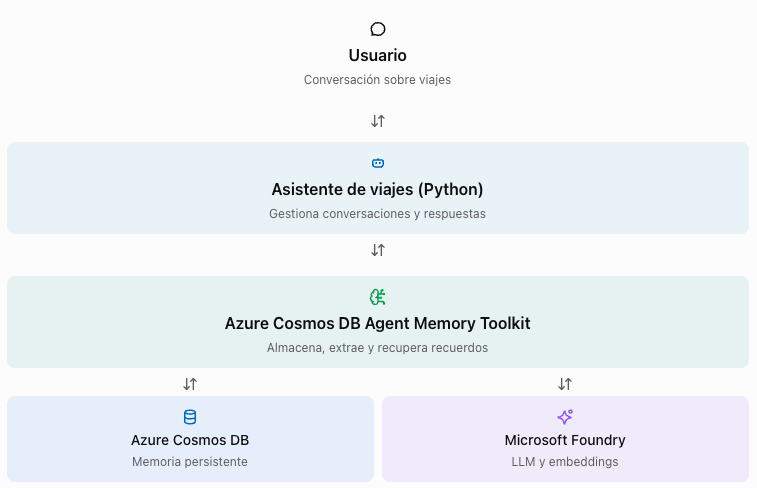

Usaremos las operaciones reales `upsert_memory()`, `process_now()`, `get_user_summary()` y `search_cosmos()` del SDK oficial. El procesamiento se hará dentro de Python, sin *Durable Functions* por ahora (eso será en el Demo 4).

### Prerrequisitos

| Requisito | Detalle |
|---|---|
| Python | *Python 3.11* o superior |
| Azure | *Azure CLI* y acceso a una suscripción de *Azure* |
| Base de datos | *Azure Cosmos DB* |
| Modelos | *Microsoft Foundry* (o *Azure OpenAI*) con uno de *chat* y otro de *embeddings* |
| Permisos | **Cosmos DB Built-in Data Contributor** y *Cognitive Services OpenAI User* |

Este demo se ejecuta sobre una cuenta real dado que podemos implementar funciones de búsqueda vectorial, índices y autenticación gracias al toolkit. Desafortunadamente, con el emulador de CosmosDB esto aún no es posible.

### 1. Clonar el repositorio oficial e instalar dependencias

Ejecuta desde la terminal:

```bash
git clone https://github.com/AzureCosmosDB/AgentMemoryToolkit.git
cd AgentMemoryToolkit
```

Instala las dependencias:

```bash
python3 -m venv .venv
source .venv/bin/activate

python -m pip install --upgrade pip
python -m pip install -e .
python -m pip install python-dotenv
```

Abre el archivo `pyproject.toml` y establece la versión de `azure-cosmos-agent-memory` en `0.3.0b1`. Guarda el archivo.

Luego ejecuta estos comandos:

```bash
uv lock

uv sync
```

### 2. Preparar los recursos de Azure

Ejecuta estos comandos paso a paso

```bash
az login

azd auth login

azd env new memorytoolkit-dev
azd env set AZURE_LOCATION eastus2

azd up
```

El comando `azd up` utiliza las plantillas *Bicep* del repositorio para crear recursos: Cosmos DB, los despliegues de modelos, identidades y otros componentes. También puede crear una Function App que utilizaremos posteriormente. Necesitarás cuota para los modelos en la región elegida y permisos para crear recursos y asignar roles.

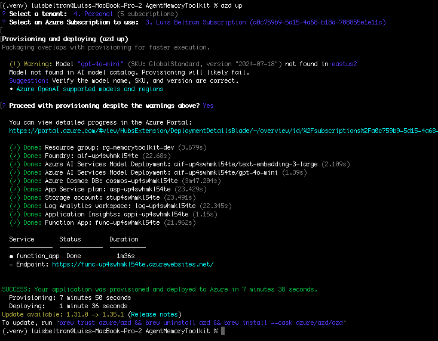

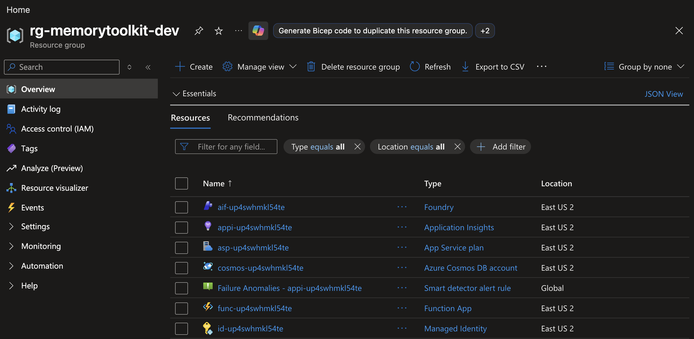

### 3. Configura las variables de entorno

Carga las variables generadas con:

```bash
set -a
source .azure/memorytoolkit-dev/.env
set +a
```

Usa el endpoint correspondiente al recurso y al tipo de despliegue compatible con el SDK

Dado que iniciamos sesión con `az login`, utilizaremos `DefaultAzureCredential` en nuestro código.

### 4. Crear el agente

Copia el archivo `demo2_memory_agent.py` que está en la carpeta `scripts` de este repositorio y pégalo dentro de la raíz del repositorio que has clonado (`AgentMemoryToolkit`).

Instala también el cliente `OpenAI` para que nuestro asistente pueda generar respuestas:

```bash
python -m pip install openai azure-identity
```

El script `demo2_memory_agent.py` utiliza el SDK oficial para la persistencia y el procesamiento de memoria, y Azure OpenAI para generar las respuestas.

Elementos principales:

| Operación | Función |
| --- | --- |
| connect_cosmos() | Conecta y prepara el almacén de memoria |
| get_user_summary() | Obtiene el perfil persistente del usuario |
| search_cosmos() | Recupera recuerdos relevantes para la consulta |
| upsert_memory() | Guarda mensajes del usuario y del agente |
| process_now() | Procesa la conversación para generar memoria derivada |

Los métodos proceden de la API pública del `Agent Memory Toolkit`. 

En este ejemplo hemos separado la generación de respuestas del almacenamiento para que puedas mostrar claramente qué operación realiza cada servicio.

### 5. Ejecutar el demo

**Primera ejecución: almacenar las preferencias**

En la terminal, ejecuta:

```bash
python demo2_memory_agent.py
```

Introduce estos mensajes, uno por uno:

```text
Me gusta viajar en tren y visitar ciudades históricas.
```

```text
Cuando viajo, prefiero hoteles que cuesten menos de 120 euros por noche.
```

```text
También me interesan los museos de historia y prefiero actividades culturales.
```

Finalmente, introduce

```text
exit
```

El programa ejecutará el método `process_now()` y mostrará el perfil generado. La redacción exacta dependerá del modelo, pero debería incluir preferencias como transporte en tren, viajes culturales y presupuesto hotelero.

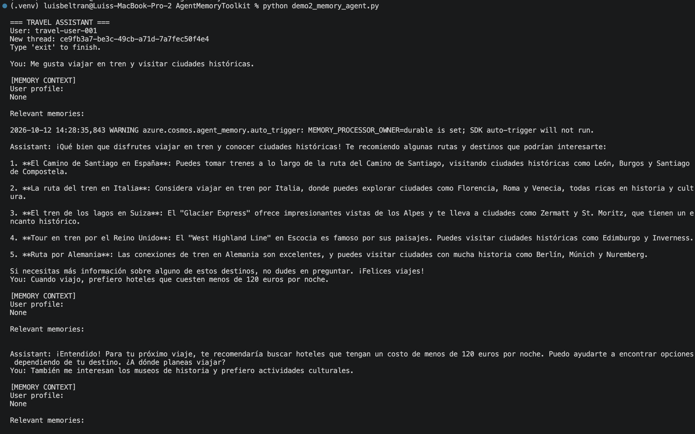

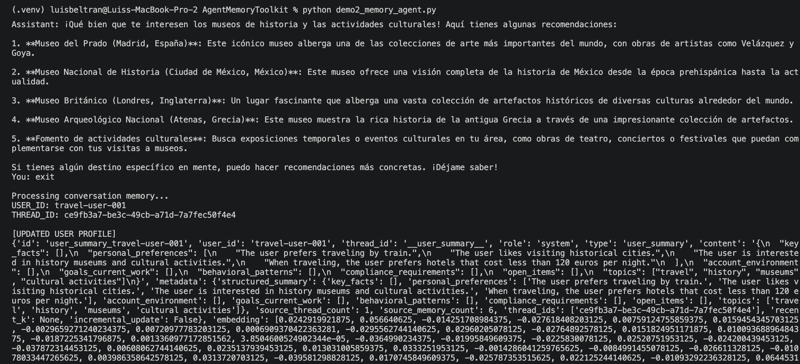

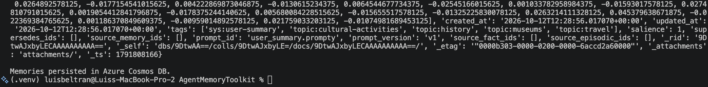

**Segunda ejecución: recuperar memoria persistente**

Cierra la aplicación (si no está cerrada ya) y vuelve a ejecutarla:

```bash
python demo2_memory_agent.py
```

El programa genera un nuevo `thread_id`, pero conserva el mismo `USER_ID`.

Ahora pregunta lo siguiente:

```text
Quiero visitar Praga durante tres días. ¿Qué itinerario y alojamiento me recomendarías según mis preferencias?
```

El agente debería recuperar información de la sesión anterior y utilizarla para personalizar su respuesta.

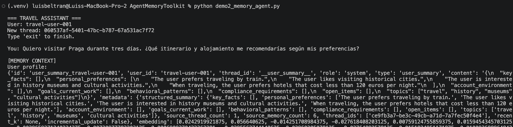

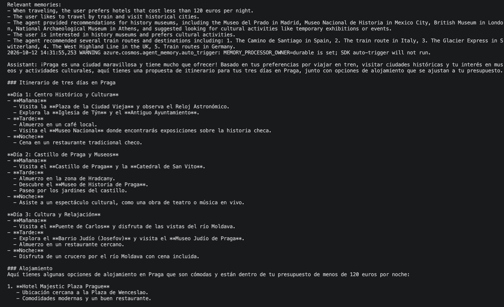

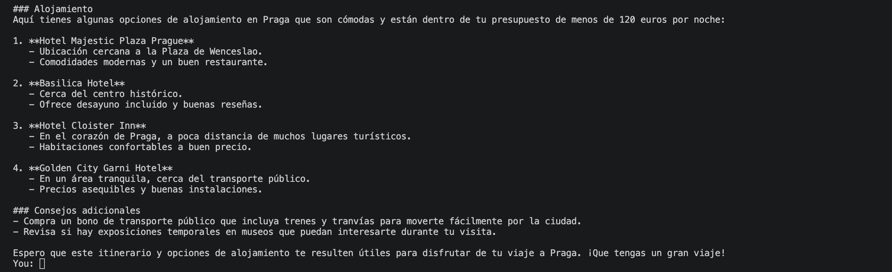

No estamos repitiendo las preferencias en la segunda conversación. El contexto ha sido recuperado del almacenamiento persistente de Cosmos DB.

### 6. Inspeccionar los recuerdos en Azure Cosmos DB

Abre **Azure Portal** y navega a tu **cuenta de Cosmos DB**. Da clic en **Data Explorer** y elige `ai_memory`.

El toolkit utiliza varios contenedores para separar diferentes tipos de memoria.

| Contenedor | Contenido |
| --- | --- |
| memories_turns | Mensajes originales de las conversaciones |
| memories | Hechos, recuerdos episódicos e instrucciones extraídas |
| memories_summaries | Resúmenes de conversaciones y perfiles de usuario |

La topología actual del repositorio utiliza estos tres tipos de almacenamiento, con claves de partición jerárquicas basadas en usuario y conversación. 

En Data Explorer puedes ejecutar una consulta como:

```sql
SELECT
    c.id,
    c.user_id,
    c.type,
    c.content
FROM c
WHERE c.user_id = "travel-user-001"
```

Ejecuta la consulta sobre `memories`, y después inspecciona `memories_summaries` para mostrar los perfiles persistentes.

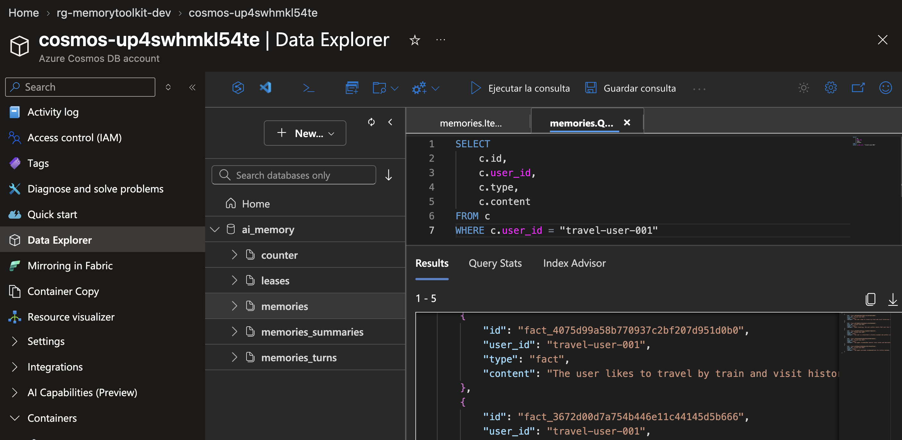

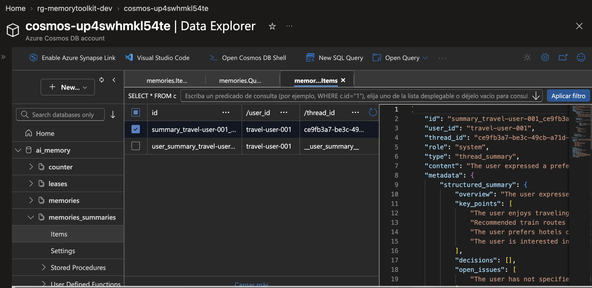

[← Demo 1](demo1.md) | [Demo 3 →](demo3.md)