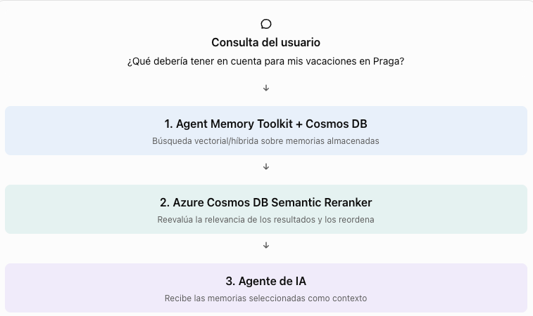
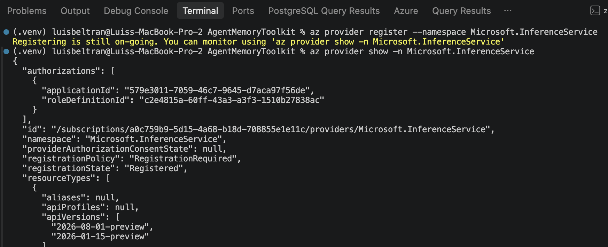
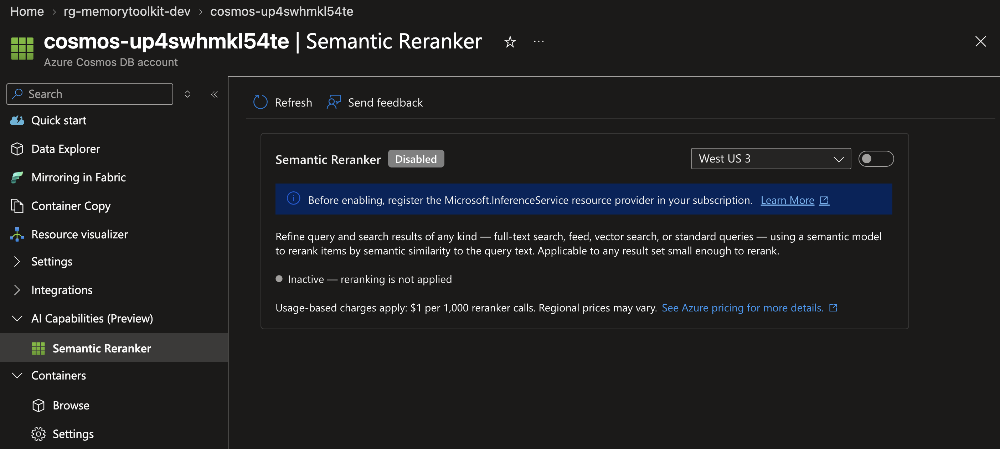
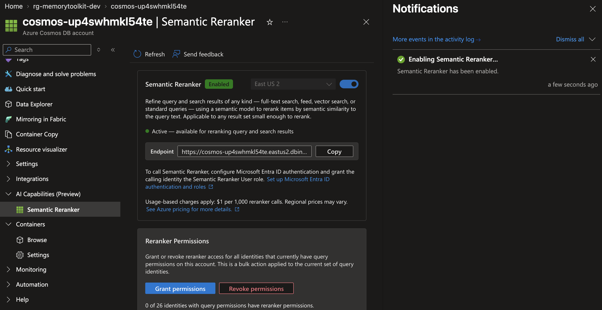
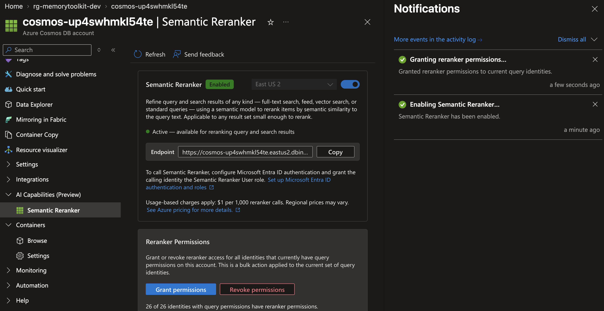
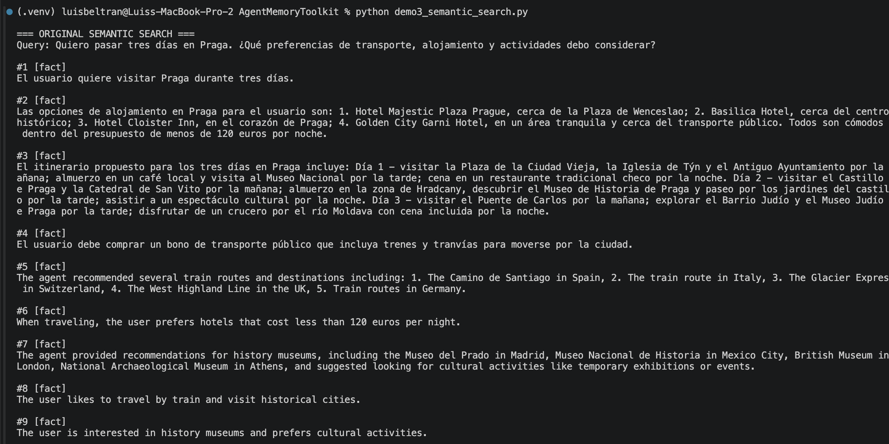
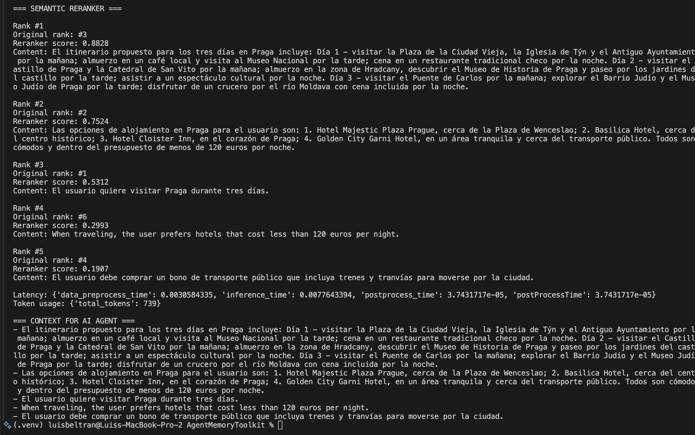
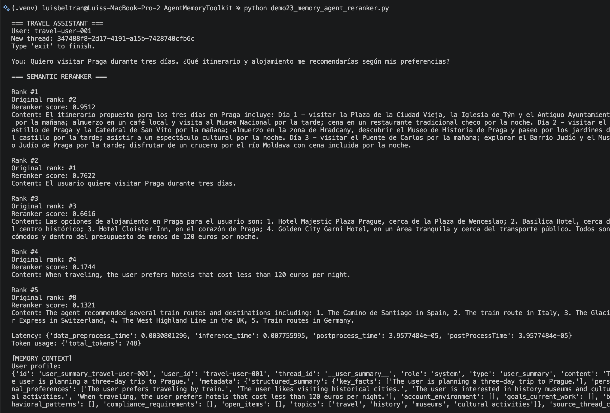
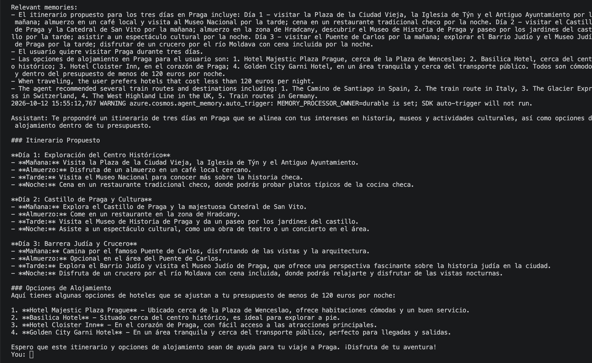

## Demo 3: Búsqueda semántica y Semantic Ranker

Ahora vamos a demostrar cómo un agente recupera recuerdos relevantes mediante búsqueda semántica y cómo Semantic Reranker puede mejorar el orden de esos resultados antes de entregárselos al modelo de IA.

### Lo que vamos a demostrar:



La búsqueda semántica recupera candidatos relevantes, mientras que **Semantic Reranker** utiliza otro modelo para volver a evaluar y ordenar esos candidatos según la intención de la consulta.

### 1. Instalar o actualizar dependencias

Desde la terminal, usando el entorno virtual creado con anterioridad, ejecuta:

```bash
python -m pip install --upgrade \
  azure-cosmos \
  azure-cosmos-agent-memory \
  azure-identity \
  python-dotenv
```

### 2. Habilitar Semantic Ranker

Esta funcionalidad está en vista preliminar a la fecha de hoy, por lo que requiere activación por cada cuenta de Cosmos DB.

Primero, registra el proveedor de recursos si todavía no está registrado:

```bash
az provider register --namespace Microsoft.InferenceService
```



Después, en Azure Portal:
1. Abre tu cuenta de **Azure Cosmos DB**.

2. Localiza la sección **AI Capabilities (Preview)**, y selecciona **Semantic Reranker**.



3. Habilita la funcionalidad y obtén el **punto de conexión de inferencia (inference endpoint)**.



4. Asigna a tu identidad el rol **Semantic Reranker User**.



El rol de **Semantic Reranker User** es diferente del rol **Cosmos DB Built-in Data Contributor** utilizado para acceder a los documentos.

### 3. Añadir una variable de entorno

En el archivo `.env` del proyecto, añade la variable:

```bash
AZURE_COSMOS_SEMANTIC_RERANKER_INFERENCE_ENDPOINT="Copia el endpoint real proporcionado al habilitar Semantic Reranker"
```

Carga las variables de entorno con:

```bash
set -a
source .azure/memorytoolkit-dev/.env
set +a
```

### 4. Crear el código del demo

Copia el archivo `demo3_semantic_search.py` que está en la carpeta `scripts` de este repositorio y pégalo dentro de la raíz del repositorio que has clonado (`AgentMemoryToolkit`).

El programa hará cuatro cosas:

| Paso | Acción |
| --- | --- |
| 1 | Recuperar hasta 15 recuerdos utilizando `search_cosmos()`. |
| 2 | Mostrar el orden original de los recuerdos. |
| 3 | Enviar los candidatos al *Semantic Reranker* de Cosmos DB. |
| 4 | Comparar los rankings y preparar el contexto que consumiría el agente. |

El programa utiliza `search_cosmos()` del toolkit y `container.semantic_rerank()` del SDK de Cosmos DB. 

Consideración: **Semantic Reranker** no añade recuerdos ni mejora automáticamente su contenido. Solo reordena los candidatos recibidos. En este ejemplo, el límite inicial es de 15 documentos, por debajo del máximo de 50 admitidos por llamada.

### 5. Ejecutar el demo

Desde la terminal:

```bash
python demo3_semantic_search.py
```

La documentación del repositorio contiene ejemplos de distintas revisiones con argumentos como `query_text/top` y `search_terms/top_k`.

Si la Demo 2 generó suficientes recuerdos, podrías encontrar resultados similares a estos:

| Orden | Antes de Semantic Reranker |
| --- | --- |
| #1 | Prefiere hoteles por debajo de 120 € por noche. |
| #2 | Prefiere viajar en tren. |
| #3 | Le interesan las actividades culturales. |



| Orden | Después de Semantic Reranker |
| --- | --- |
| #1 | Prefiere hoteles por debajo de 120 € por noche. |
| #2 | Le interesan las actividades culturales. |
| #3 | Prefiere viajar en tren. |



**Semantic Reranker** reordena los recuerdos según su relevancia semántica respecto a la consulta del usuario, no según la fecha, la cantidad de palabras coincidentes ni únicamente la similitud vectorial.

Utiliza un modelo de IA de Microsoft (*Microsoft AI Semantic Ranker*) para evaluar qué documentos responden mejor a la intención de la consulta. 

En resumen, el modelo evalúa estos aspectos de relevancia para reordenar los resultados:

| Aspecto | Qué evalúa |
| --- | --- |
| Relevancia semántica | Qué tan relacionado está el significado del recuerdo con la consulta. |
| Intención del usuario | Si el recuerdo aporta información útil para responder lo que está solicitando. |
| Contexto | Interpreta las relaciones conceptuales, aunque no se utilicen exactamente las mismas palabras. |
| Cobertura de la consulta | Qué aspectos de la necesidad del usuario aborda el recuerdo. |

En Azure Cosmos DB, **Semantic Reranker** devuelve una puntuación entre `0` y `1` para cada documento, donde **un valor mayor indica mayor relevancia semántica**.

Específicamente, el criterio de reordenamiento se establece en este código:

```python
response = container.semantic_rerank(
    context=QUERY,
    documents=documents,
    options={
        "return_documents": True,
        "top_k": 5,
        "sort": True,
        "document_type": "json",
        "target_paths": "content"
    }
)
```

* `context=QUERY`: define la consulta o intención respecto a la cual se evalúan los documentos.

* `target_paths="content"`: indica qué campo del documento se analiza.

* `sort=True`: ordena los resultados por puntuación de relevancia descendente.

* `top_k=5`: devuelve los cinco resultados mejor puntuados.

Si tienes únicamente tres memorias muy relevantes, puede que el reordenamiento no cambie demasiado. Para una demostración más convincente, puedes generar previamente entre 10 y 15 recuerdos variados: transporte, presupuesto, museos, gastronomía, clima, viajes anteriores e intereses personales.

### 6. Conectar el resultado con el agente de la Demo 2

Vamos a integrar el resultado de **Semantic Reranker** en la función que genera las respuestas del agente mostrado en el Demo 2.

En `demo2_memory_agent.py`, sustituye la recuperación del contexto por una función que primero busque y después reordene las memorias:

```python
def get_context(user_message: str) -> str:
    hits = memory.search_cosmos(
        user_id=USER_ID,
        query_text=user_message,
        top=15
    )

    ranked_hits = rerank_memories(
        hits,
        query=user_message
    )

    return "\n".join(
        f"- {item['content']}"
        for item in ranked_hits[:5]
    )
```

Ejecuta de nuevo el script `demo2_memory_agent.py` y observa los resultados:





[← Demo 2](demo2.md) | [Demo 4 →](demo4.md)