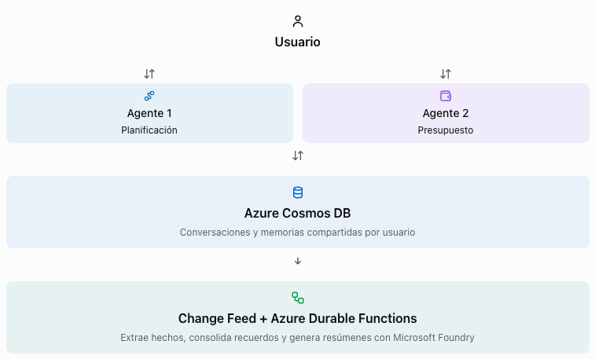
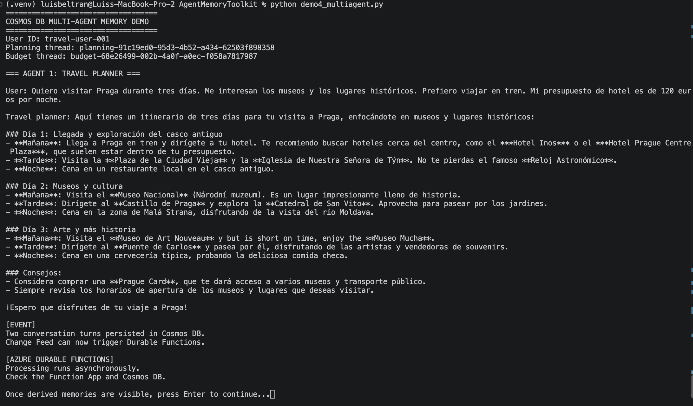
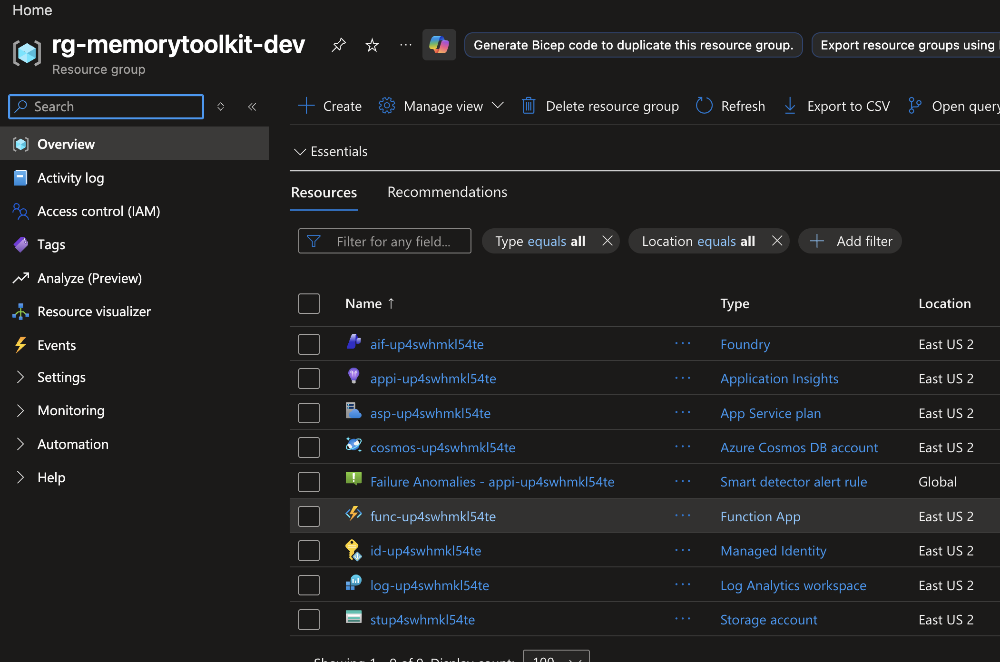
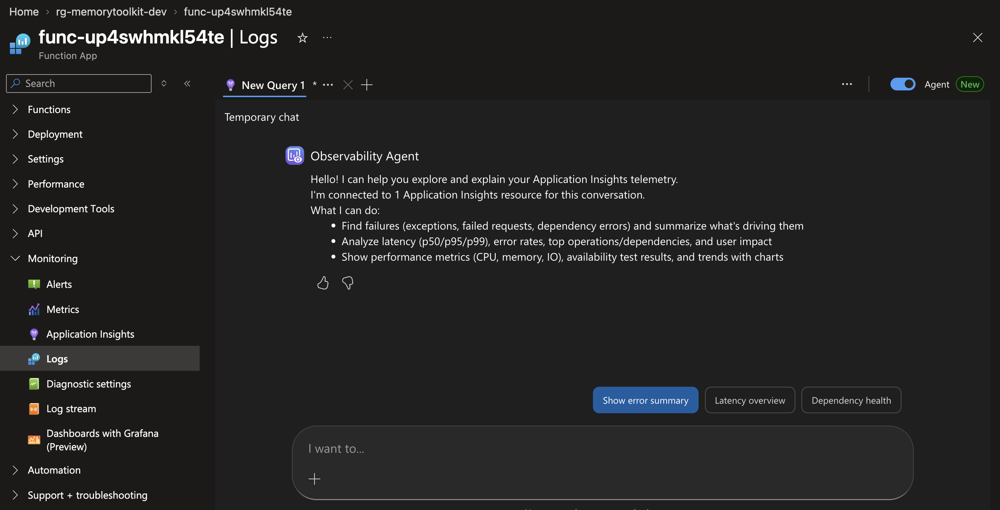
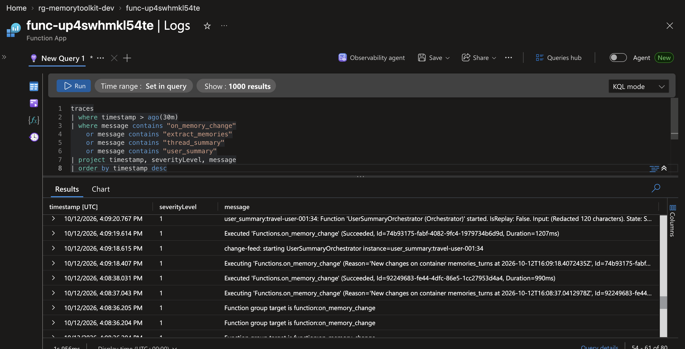
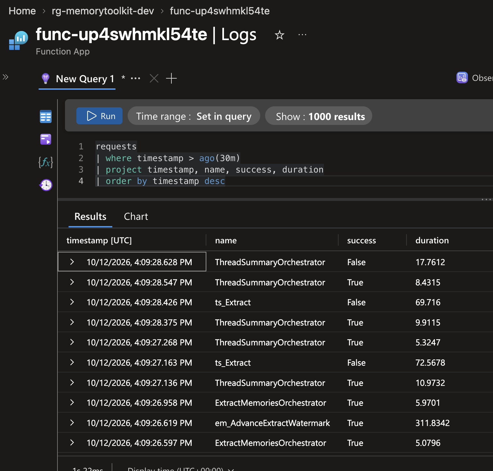
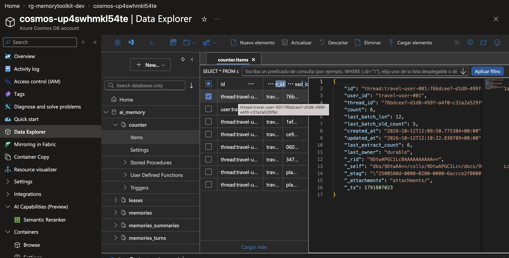
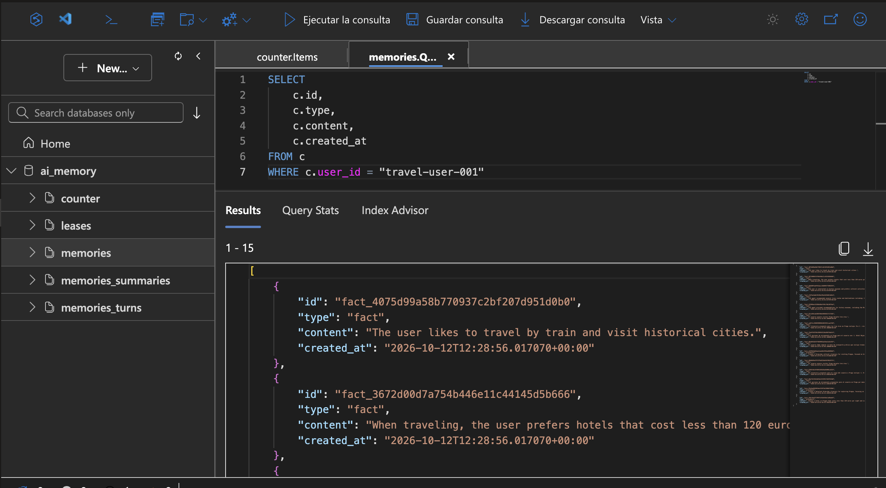
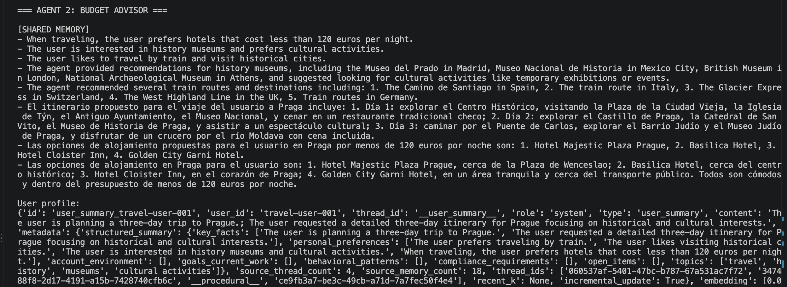
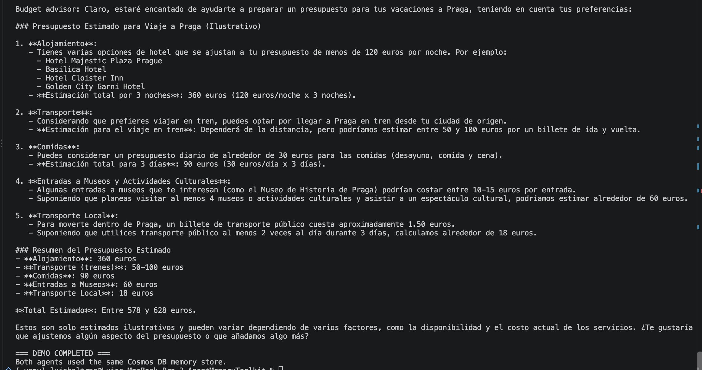

## Demo 4: Durable Functions y memoria compartida entre agentes

Ahora queremos demostrar que dos agentes especializados pueden compartir memorias persistentes almacenadas en **Azure Cosmos DB** y que con **Azure Durable Functions** podemos procesar esas memorias automáticamente mediante **Change Feed**, sin llamar manualmente a process_now().

Continuaremos con el asistente de viajes de las demos anteriores.

### Qué vamos a construir

En esta demo tendremos dos agentes:

- Agente de planificación: recibe las preferencias del usuario y las almacena en Cosmos DB.

- Agente de presupuesto: consulta las memorias generadas por el primer agente y recomienda opciones de viaje personalizadas.



El toolkit oficial ya incluye la **Function App**, los orquestadores y el procesamiento mediante **Change Feed**. No necesitamos programar una Azure Function desde cero. Solo desplegar la infraestructura y utilizar `DurableFunctionProcessor` en Python

### 1. Preparar Azure Durable Functions

Primero vamos a comprobar los recursos de la Demo 2, entre ellos la creación de un recurso **Azure Functions**.

En la raíz del repositorio `AgentMemoryToolkit`, ejecuta:

```bash
azd env select memorytoolkit-dev
azd env get-values
```

Ahora vamos a configurar los umbrales de procesamiento.

Para que los asistentes vean el funcionamiento del procesamiento automático con pocos mensajes, configuraremos los umbrales para la charla:

```bash
azd env set MEMORY_PROCESSOR_OWNER durable
azd env set FACT_EXTRACTION_EVERY_N 2
azd env set THREAD_SUMMARY_EVERY_N 2
azd env set USER_SUMMARY_EVERY_N 2
azd env set DEDUP_EVERY_N 0
```

| Parámetro | Valor | Comportamiento |
|---|---:|---|
| `MEMORY_PROCESSOR_OWNER` | `durable` | Durable Functions es responsable del procesamiento |
| `FACT_EXTRACTION_EVERY_N` | `2` | Extrae hechos cada dos mensajes |
| `THREAD_SUMMARY_EVERY_N` | `2` | Actualiza el resumen de conversación |
| `USER_SUMMARY_EVERY_N` | `2` | Actualiza el perfil del usuario |
| `DEDUP_EVERY_N` | `0` | Desactiva la reconciliación automática de hechos para simplificar la demo |

Normalmente se utilizarían umbrales más elevados para reducir llamadas a modelos y costes operativos.

Actualicemos el despliegue con el siguiente comando:

```bash
azd up
```

Este comando aplica la configuración de infraestructura y actualiza las variables de la **Function App**.

Carga las variables en tu terminal:

```bash
set -a
source .azure/memorytoolkit-dev/.env
set +a

export MEMORY_PROCESSOR_OWNER=durable
```

Esto evita que el SDK ejecute paralelamente el procesamiento automático local.

**La configuración es importante: Microsoft advierte que, si el SDK y Durable Functions procesan los mismos mensajes simultáneamente, pueden duplicarse las extracciones y los costes.**

### 2. Crear el código de los 2 agentes

Copia el archivo `demo4_multiagent.py` que está en la carpeta `scripts` de este repositorio y pégalo dentro de la raíz del repositorio que has clonado (`AgentMemoryToolkit`).

Mantendremos los dos agentes en un único archivo. Cada uno tendrá su propio `thread_id`, pero ambos compartirán el mismo `user_id` y el mismo **almacén de memoria**.

Instala las dependencias, si todavía no están instaladas:

```bash
python -m pip install \
  azure-cosmos-agent-memory \
  azure-identity \
  openai \
  python-dotenv
```

Este ejemplo emplea `DurableFunctionProcessor()`, tal y como documenta el repositorio oficial. No se invoca ninguna Azure Function directamente: el SDK escribe los mensajes y `Change Feed` se encarga de iniciar su procesamiento. 

> Nota: este programa coordina dos asistentes especializados de manera secuencial, cada uno con su propio prompt y conversación. Es suficiente para demostrar memoria multiagente compartida, pero no es todavía una orquestación formal con Microsoft Agent Framework por ejemplo.

El código conserva el identificador `travel-user-001` de las demostraciones anteriores. Para distinguir visualmente los recuerdos antiguos de los nuevos, utilizaremos los nuevos identificadores de conversación que se imprimen al principio.

### 3. Ejecutar el demo

En la terminal de VS Code ejecuta:

```bash
python demo4_multiagent.py
```

**Primera parte: agente de planificación**

El programa ejecutará automáticamente el primer agente y almacenará dos mensajes. La consola mostrará una salida semejante a:



Ahora, mientras el programa está detenido esperando que pulses `Enter`, cambia al Portal de Azure para observar el procesamiento.

### 4. Comprobar que Durable Functions procesó los recuerdos

Primero, hay que identificar la **Function App** desde las variables del despliegue o en el portal.



Ahora, vamos a observar **Change Feed y Durable Functions**

En el Portal de Azure, navega a tu recurso **Function App**. Dentro de la sección **Monitoring**, elige **Logs**.



Descarta el modo agente y cambia al modo **KQL**. Escribe esta consulta KQL y ejecútala:

```kusto
traces
| where timestamp > ago(30m)
| where message contains "on_memory_change"
    or message contains "extract_memories"
    or message contains "thread_summary"
    or message contains "user_summary"
| project timestamp, severityLevel, message
| order by timestamp desc
```



Los nombres de los eventos pueden variar según la versión y la instrumentación de la Function App.

Lo importante es identificar que se ha iniciado y ejecutado el procesamiento después de escribir los mensajes en Cosmos DB.

También puedes consultar las ejecuciones y excepciones:

```kusto
requests
| where timestamp > ago(30m)
| project timestamp, name, success, duration
| order by timestamp desc
```



**A continuación, inspeccionemos Cosmos DB**

En el Portal de Azure abre tu recurso de **Cosmos DB Account**, accede al **Data Explorer** y selecciona `ai_memory`.

Inspecciona los siguientes contenedores:

| Contenedor | Qué mostrar |
|---|---|
| `memories_turns` | Los nuevos mensajes del agente de planificación |
| `counter` | Los contadores utilizados para activar las orquestaciones |
| `memories` | Los hechos extraídos automáticamente |
| `memories_summaries` | Los resúmenes generados |



Para observar los hechos (`fact`), selecciona el contenedor `memories`, da clic derecho y ejecuta la siguiente consulta:

```sql
SELECT
    c.id,
    c.type,
    c.content,
    c.created_at
FROM c
WHERE c.user_id = "travel-user-001"
```



Cuando **Durable Functions** termine la extracción, deberías encontrar recuerdos relacionados con el interés del usuario por la historia, los museos, el transporte ferroviario y el presupuesto de alojamiento.

La extracción puede tardar unos segundos o más, dependiendo del arranque de la **Function App** y de las llamadas al modelo. Por eso el código permite esperar hasta comprobar que se generaron las memorias.

**Vamos a ejecutar el segundo agente.**

Vuelve a la consola y presiona Enter.

El programa recuperará los recuerdos del usuario, aunque procedan de una conversación iniciada por otro agente.

La salida sería:





Esto demuestra que el segundo agente ha recuperado memoria generada a partir de la conversación del primero.

### Diferencias entre el Demo2 y el Demo4:

1. **Procesamiento automático frente al de la Demo 2.** En la Demo 2 llamábamos a `process_now()` para procesar inmediatamente los mensajes. En esta demo utilizamos `DurableFunctionProcessor`, por lo que `process_now()` ya no hace lo mismo: el procesamiento lo realiza la **Function App** a partir de **Change Feed**.

2. **Memoria compartida.** Los dos agentes tienen conversaciones separadas, pero comparten el mismo identificador de usuario. No significa que puedan leer las memorias de cualquier persona; en producción debes controlar el aislamiento por usuario y los permisos.

3. **Extracción de hechos.** El umbral configurado en dos mensajes debería permitir activar el procesamiento con un intercambio entre usuario y agente. No garantiza que el modelo extraiga un número específico de hechos ni que finalice antes de pasar a la siguiente pantalla.

4. **Costes**. Al utilizar Durable Functions, Cosmos DB y Microsoft Foundry, existen costes reales asociados al almacenamiento, las operaciones de base de datos, la ejecución y los tokens de inferencia.

### Referencias

Estas son las fuentes en las que se basa la implementación mostrada el día de hoy:

- [Azure Cosmos DB Agent Memory Toolkit](https://github.com/AzureCosmosDB/AgentMemoryToolkit/blob/main/infra/README.md) — SDK y arquitectura general.

- [Infraestructura con Azure Developer CLI](https://github.com/AzureCosmosDB/AgentMemoryToolkit/blob/main/infra/README.md) — despliegue de Azure Functions, Change Feed y configuración de umbrales.

- [Deploying and Testing in Azure](https://github.com/AzureCosmosDB/AgentMemoryToolkit/blob/main/Docs/azure_testing.md) — validación del procesamiento automático.

- [Memory Design Patterns](https://github.com/AzureCosmosDB/AgentMemoryToolkit/blob/main/Docs/design_patterns.md) — patrón de memoria compartida entre agentes.

[← Demo 3](demo3.md)